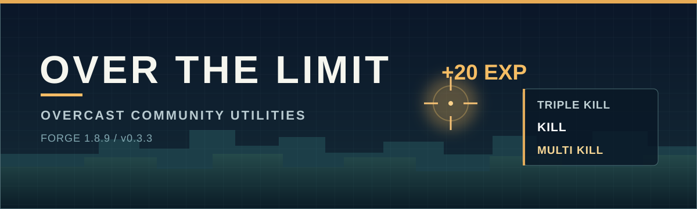

# Overcast Community Server Utilities



**Over The Limit (OTL) v0.3.3** is a client-side Forge 1.8.9 mod for the Overcast Community server. Press **P** for the HUD editor and modules; press **J** for Face Rig. [Download the release](https://github.com/Gr3nDy/Over-The-Limit/releases/tag/v0.3.3) · [What's new](CHANGELOG.md)

## Modules

| Module | What it does |
| --- | --- |
| **Face Rig** | Animates skin-based eyes and expressions; includes an in-game editor. |
| **Reliable Chat** | Adds channel/PM tabs, drafts, scrollable history and optional team speech bubbles. |
| **Map Preview** | Shows book/chat map previews, a searchable gallery and `/map` info cards. |
| **Prefered Hand** | Visually chooses the first-person hand for items, blocks, tools or weapons. |
| **Kill Feed** | Displays deaths, causes and weapons with a configurable HUD and history. |
| **Kill Confirm** | Shows queued kill tags, streaks and immediate EXP feedback; OFF by default. |
| **Server Notices** | Separates server announcements from chat in a standalone HUD; OFF by default. |

## Download

Download `OTL.jar` from the [v0.3.3 release](https://github.com/Gr3nDy/Over-The-Limit/releases/tag/v0.3.3) or [browse all releases](https://github.com/Gr3nDy/Over-The-Limit/releases).

Place `OTL.jar` in your Forge 1.8.9 client's `mods` folder manually. This build has not been verified in a live Lunar/OCC session.

The source branch is `beta`. It does not contain compiled JAR files.

## Build

Use JDK 8 and run:

```text
gradlew.bat clean build --offline --no-daemon
```

The verified, reobfuscated, smoke-free `OTL.jar` is created in `build/libs/`.
Copy it to your client manually. No build task installs anything into Lunar or another client.
Development and smoke jars stay in `build/dev-libs/`, so `runClient` cannot overwrite the manual-copy release.

Tests only: `gradlew.bat test --offline --no-daemon`.
In-game fixtures: `gradlew.bat runClient -PotlSmoke --offline --no-daemon`.
For a focused run, add `-PotlSmokeScope=killconfirm` (or another module name); use the full run for shared-code changes.
Add `-PotlSmokeRemote` to require live lookups from **both** map repositories. Without it, remote checks are explicitly disabled, not reported as passed.

## License

Licensed under the **GNU General Public License v3.0**. See `LICENSE`.
